# Pragmatic Audio PEQ

**A system-wide parametric EQ for your headphones.** Load a correction for your headphones (OPRA, AutoEq and the measurement
sites), edit it, make your own, and hear it on everything you play. Made by [Pragmatic Audio](https://www.pragmaticaudio.com/).

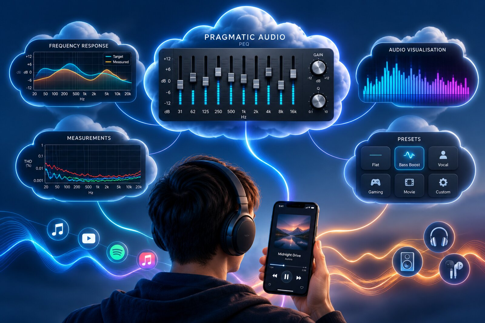

This repository holds the **downloads** (see [Releases](../../releases)). The source is not published here. The full write-up,
with every screen explained, is on the website:
**[Pragmatic Audio PEQ: the article](https://www.pragmaticaudio.com/articles/2026/10/pragmatic-audio-peq/)**.

## What's new in 1.0.3 (build 43)

### Make your own PEQ from a measurement

Until now you needed someone else to have published a PEQ for your headphones. Now you can **start from a measurement of
them** and let the app work out the EQ. Open **Create** and choose *From measurements*:

1. **Pick a measurement.** Choose one from Pragmatic Audio's own measurements, **search Squig.link** across its public
   databases, or browse other measurement sites in the app. If you only have a graph, **choose a picture of it** (the app
   reads the line and its scales, with on-device text recognition to find them) or load a raw `.txt` measurement file.
2. **Choose what to design against.** The Harman and other published targets and the preference ranges from the research
   behind them, with options to line the response up over the bass, mids or both.
3. **Let the app fit it.** **Smart EQ** refines the filters together against the preference range; **Auto EQ** fits the
   chosen number of bands to the middle of the range, or to the target itself. Defaults keep the correction below 4 kHz, where
   measurements are most trustworthy, and you can change that, the number of bands, the largest gain and how narrow peaks at
   4-10 kHz are treated.
4. **Hear it before you keep it.** The graph shows the headphone before and after, and the distance from the target in dB.
   Listen to the EQ on your current output while you adjust it, then open it in the editor like any other PEQ.

Measurements are only read to design an EQ on your device. Nothing is downloadable through the app, so please visit
[Squig.link](https://squig.link/) and [Hangout Audio](https://graph.hangout.audio/) for the data themselves, and thank
them for it.

### Also new in build 43

- **Devices with their own PEQ.** On Mac and Android, send a PEQ straight to USB DACs, dongles and amps that have one built in
  (FiiO, Moondrop, Walkplay, Topping, JDS Labs, KT Micro, Qudelix and more), and to LUXSIN and WiiM devices on your network,
  with a picture of each. Which devices have been tried on real hardware varies; the LUXSIN X9 has.
- **Audio recovery** on macOS and iPhone/iPad: if Pragmatic EQ is selected but the app is not responding, a helper restores
  your previous output after 10 seconds.
- **About** thanks the people whose measurements and research the app builds on.

### macOS 1.0.3 (build 40) and earlier

- **Audio recovery.** A separate background helper offers a notification to open
  PEQ if Pragmatic EQ is selected without a responsive app. After 10 seconds it
  restores the previous real output if the app has not connected. Allow the
  helper's notifications and background activity in macOS Settings.
- **Driver cleanup.** Remove the driver from Settings, or enable automatic removal
  after dragging the app to the Trash. New driver installations include cleanup;
  older installations need it enabled once. Profiles and preferences are kept.

## Also included since 1.0.2 (build 38)

Available in the macOS and Android downloads below. iPhone and iPad users can
download the app from the App Store (build 43 is in TestFlight and follows). The Windows download remains build 26
while a new local Windows build is prepared.

- **Adaptive navigation.** Compact portrait screens show Live, Profile, Find profile,
  A/B and Settings. Wide or landscape screens show every section in a left sidebar,
  including Create and Effects. Tabs is the default for new installations; existing
  layout preferences are retained, and One page remains available in Settings.
- **More room to edit.** Graphs and section content fill the space beside the sidebar.
  Find profile includes Create your own, and A/B has its own destination.
- **Profiles and controls.** Import separate left and right personalised filter files,
  choose a language (including Dutch), adjust Smart Headroom or the preamp manually,
  and preview bass/treble preferences with the loaded profile retained.
- **Getting started.** A Welcome guide and clearer Live instructions explain connecting
  music, finding profiles and creating your own. An audio connection alone is no
  longer treated as confirmation that music is arriving.
- **Updated icon.** Larger white PEQ lettering on a black badge.

## Downloads

Please try them and report what you find in [Issues](../../issues).

| Platform | Get it | Status |
|---|---|---|
| **macOS** (Apple silicon and Intel, macOS 14 or newer) | [1.0.3 (43) DMG](https://github.com/jeromeof/PragmaticAudioPEQ-releases/releases/download/macos-v1.0.3/Pragmatic-Audio-PEQ-1.0.3-build43.dmg) · [release notes](../../releases/tag/macos-v1.0.3) | Signed by KONECKTA LIMITED; app and DMG notarized and stapled. |
| **Windows 11** | [Build 26 installer](https://github.com/jeromeof/PragmaticAudioPEQ-releases/releases/download/windows-v1.0.0/PragmaticAudioPEQ-1.0.0-build26-Setup.exe) | Previous tester build; a new local Windows build is pending. Not code-signed. |
| **Android** (9 or newer) | [1.0.3 (43) APK](https://github.com/jeromeof/PragmaticAudioPEQ-releases/releases/download/android-v1.0.3/Pragmatic-Audio-PEQ-1.0.3-build43.apk) · [release notes](../../releases/tag/android-v1.0.3) | Release-signed with the existing Android key, so it installs over earlier APKs. Not yet run on an Android device. |
| **iPhone and iPad** (iOS 27 or later) | [Download on the App Store](https://apps.apple.com/us/app/pragmatic-audio-peq/id6818329288) | Available on the App Store. A physical device is required for live audio routing. |

Each new Mac and Android release includes a SHA-256 checksum file. The APK is for
direct installation and is separate from the Google Play submission.

The Mac app checks this page once a day and tells you when a newer version is out.

### Installing on macOS

1. Open the `.dmg` and drag **Pragmatic Audio PEQ** to Applications.
2. The first time you open it, it offers to install its audio driver, a virtual output called **Pragmatic EQ**. macOS asks for an
   administrator password, and your sound pauses for a second while the audio service restarts. Nothing is recorded.
3. Choose **Pragmatic EQ** as your sound output (the app can do that for you), and what you play is equalised.

The app lives in the menu bar and can open at login. Allow notifications and background activity for **Pragmatic Audio PEQ
Recovery** so it can offer to reopen the app and restore sound after 10 seconds without a processing connection.

**Settings → Audio settings → Mac audio driver** offers manual driver removal and automatic cleanup after the app is moved
to the Trash. Existing driver installations need automatic cleanup enabled once; new driver installs include it. Allow roughly
1–2 minutes after trashing the app. The cleanup removes the driver and its installed cleanup helper; saved profiles and settings
are kept. **Uninstall Audio Driver…** is also available in the Mac menu.

### Installing on Windows 11

1. Download `PragmaticAudioPEQ-…-Setup.exe` and run it. It needs administrator rights: it installs the app and an audio
   processing object that Windows' audio engine loads.
2. **Windows will warn you** ("Windows protected your PC"), because the installer is not yet signed with a paid code-signing
   certificate. Choose **More info**, then **Run anyway**. You can compare the file with the one on this page if you want to be sure.
3. In the app, open **Settings > Windows audio** and turn it on for **your** playback device (it is off until you do). Windows
   asks for permission, and restarts Windows audio, which stops your players for a moment. The app presses play again for you; if
   your player stays paused or silent, press play or restart it. A tray icon keeps the app running with the window closed.

Limits for now: only stereo, 32-bit float, 48 kHz has been tested (44.1 kHz, multichannel, USB DACs and exclusive mode have not),
and a few audio drivers replace Windows' effects and may drop ours (the app tells you and offers to turn it back on). If
Smart App Control is on, Windows can block the unsigned installer outright. If the effect ever fails, the sound passes through
untouched and `C:\ProgramData\PragmaticAudioPEQ\apo.log` says why. The uninstaller removes everything it added.

### Installing on Android

Android apps outside Google Play are installed by hand, which means allowing **unknown sources** once:

1. Download the `.apk` on the phone (or copy it there).
2. Open it. Android asks to allow installs from that app (your browser or file manager): choose **Settings**, switch on
   **Allow from this source**, and go back.
3. Choose **Install**. Later updates are installed the same way, over the top, and keep your settings.

Android has no system-wide output to choose, so the EQ is attached to the audio of the players that announce themselves, which
is how Wavelet and Poweramp Equalizer work. That means:

- Most music players work. A few, and some phones' own sound effects (Samsung's, Dolby's), can get in the way.
- The live views need a one-time **microphone permission** (Android uses it for audio visualisers; nothing is recorded), and Android only
  gives them coarse, mono, 8-bit audio, so they are rougher than on a Mac or iPhone.
- If the sound stutters on an older phone, raise **Settings > Android audio > Smoothness**.
- It needs Android 9 or newer.

## What it does

- **System-wide parametric EQ**, under any music app.
- **Load a PEQ** from [OPRA](https://opra.roonlabs.net/) (thousands of headphones and IEMs, every creator credited), from the
  measurement sites through their Export button, or from a `Filters.txt` file.
- **One PEQ editor**: drag the dots, change the width, type exact values, and hear every change live.
- **Make your own from a measurement**: pick a measurement of your headphones (Pragmatic Audio, Squig.link search, a picture
  of a graph or a `.txt` file), and **Smart EQ** or **Auto EQ** fits a PEQ to a target or preference range.
- **Make your own**: simple bass and treble, a fixed-band graphic EQ, an advanced editor, and **Uplifting PEQ**, a listening
  process that tunes the treble above 4 kHz to your own ears.
- **A bass and treble preference** that sits on top of any PEQ and any headphone.
- **A personalised library** you can export and import, and **pin to your headphones**, so they load their own PEQ when they
  connect.
- **A/B testing**, with volume matching, and a **blind test** with an exact result.
- **Effects**: crossfeed, a tube amp and vinyl.
- **Live visualisation**: eight views, including Visual PEQ, which shows what the EQ does to your music as it plays.
- **Headroom management**: the preamp is set from the filters, **Smart headroom** gives back volume where it safely can, and a
  limiter guards the peaks.
- **Devices with their own PEQ**: on Mac and Android, writes a PEQ to USB DACs and dongles that have one, and to LUXSIN and WiiM
  devices on your network.
- **In English, Dutch, French, Spanish, German, Italian, Chinese and Japanese.**

## A look

| | |
|---|---|
| 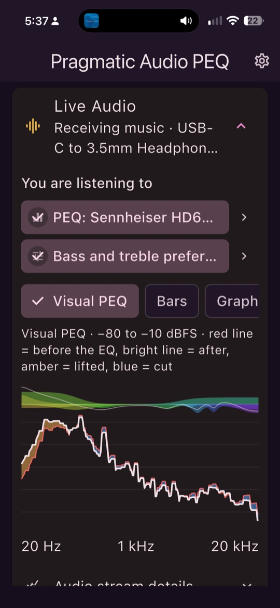 | 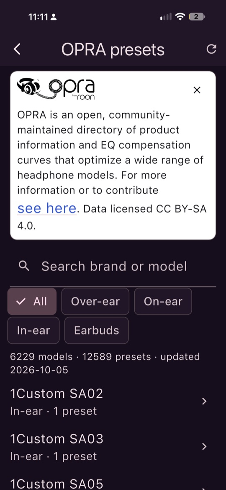 |
| **Live Audio**: what you are hearing, and what the EQ is doing to it. | **Load**: OPRA's headphones and presets, with the creator credited. |
| 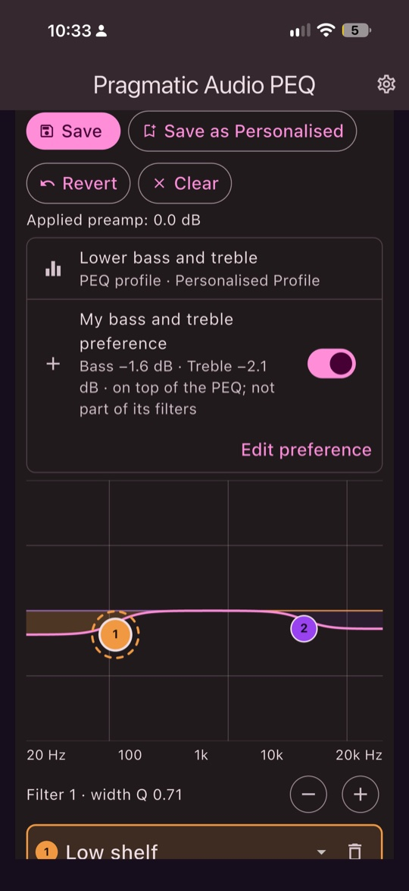 | 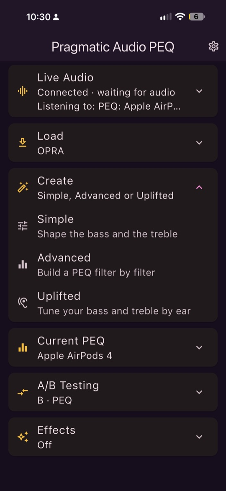 |
| **The editor**: one editor for every profile. | **Create**: Simple, Advanced or Uplifted. |
| 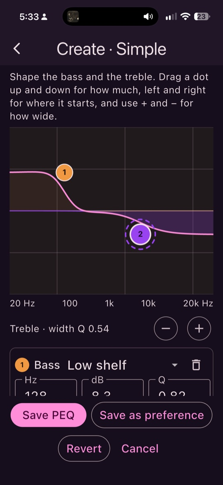 | 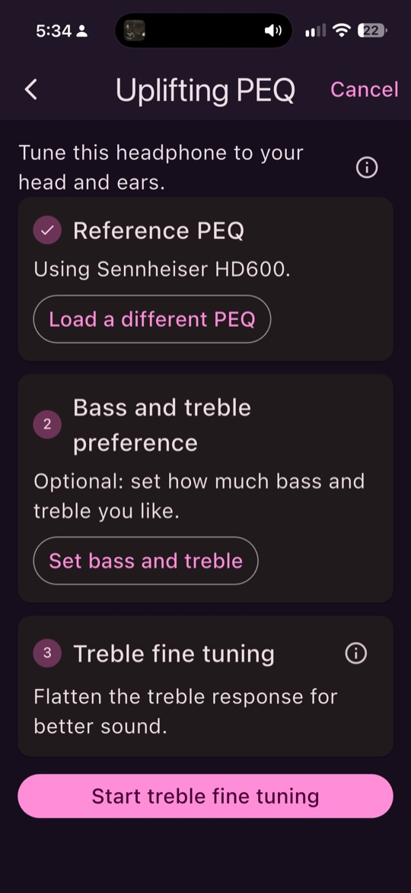 |
| **Simple**: bass and treble, heard as you move them. | **Uplifting PEQ**: tune the treble to your own ears. |
|  | 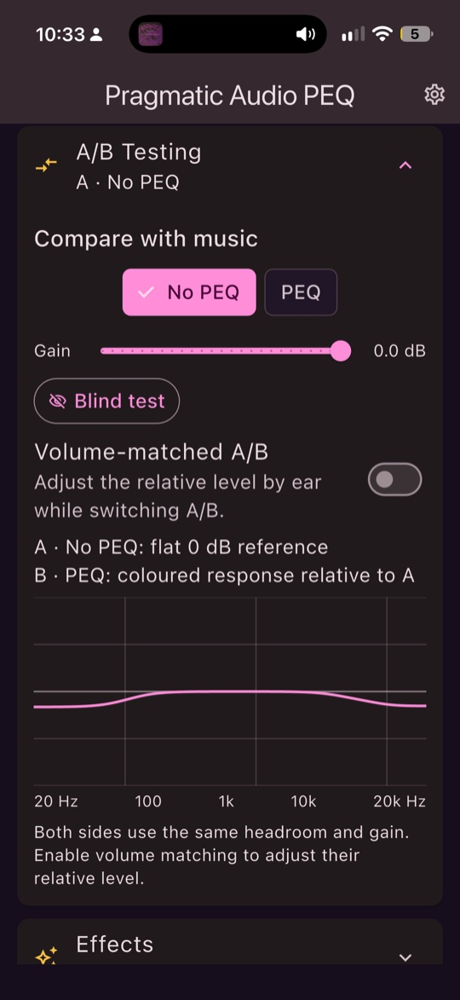 |
| **Library**: keep profiles, and pin one to your headphones. | **A/B testing**: with and without, level-matched. |
| 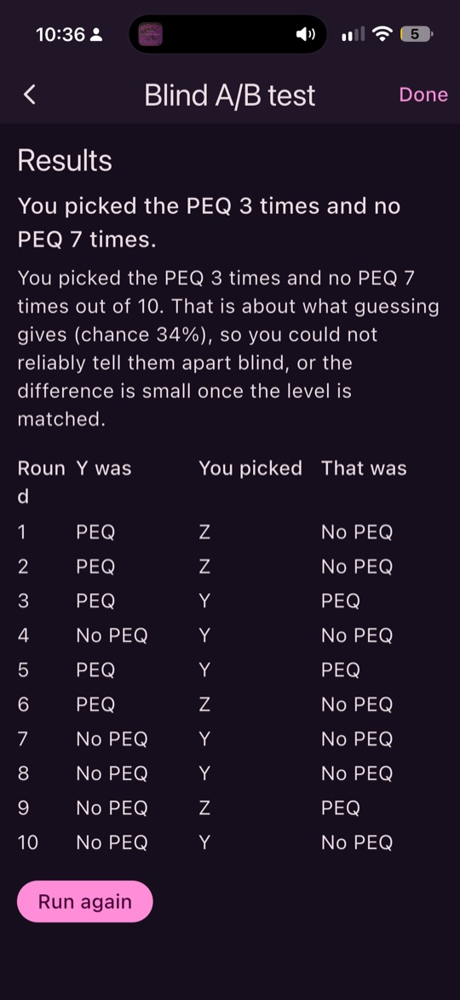 | 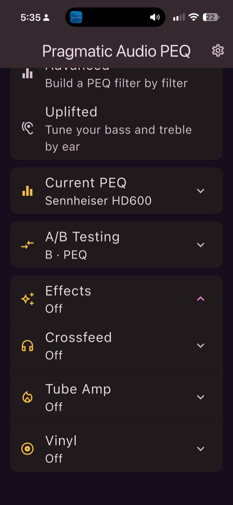 |
| **Blind test**: does the PEQ really sound different? | **Effects**: crossfeed, tube amp and vinyl. |
| 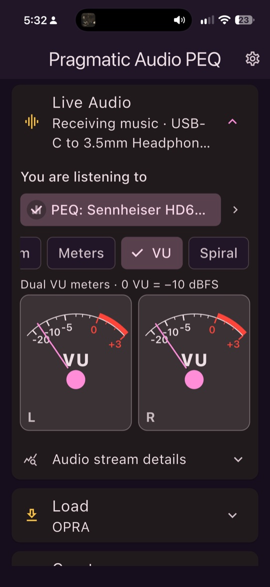 | 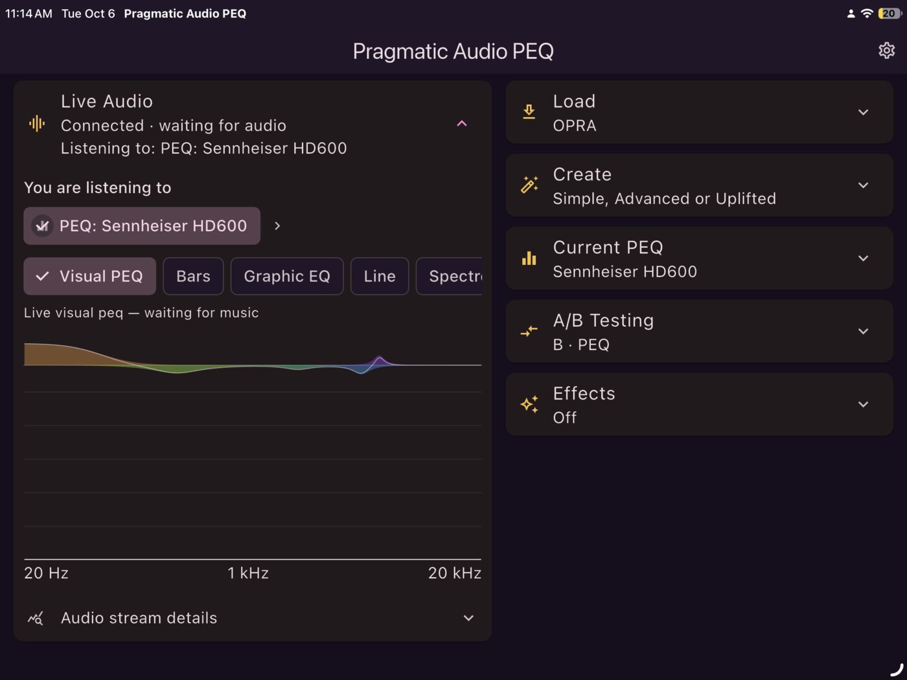 |
| **Views**: VU meters, spectrum, spiral and more. | **iPad and big windows** get two panes. |

The screenshots are from the iPhone and iPad. The Mac, Windows and Android apps are the same app and look the same, with
the parts that need the platform's own audio (the output, the driver, the effect) adapted.

## Good to know

- It does not record, store or send your audio. OPRA's preset list is downloaded (about 1 MB) when you open Load.
- Uplifting PEQ is a listening aid, not a measurement. Check it with the blind test.
- Smart headroom trusts the limiter for the occasional peak. If your music is unusually bright and loud, use Safe.
- Vinyl and Tube Amp are effects inspired by real things, not models of specific equipment.

## Support

If it is useful to you, you can [buy Pragmatic Audio a coffee](https://buymeacoffee.com/pragmaticaudio). Bug reports and
suggestions are welcome as [Issues](../../issues) in this repository.

## Credits

Headphone corrections come from [OPRA](https://opra.roonlabs.net/) and its contributors (including oratory1990 and AutoEq),
credited in the app next to every preset. Measurements to design from are published by [Squig.link](https://squig.link/),
[Hangout Audio](https://graph.hangout.audio/) and Pragmatic Audio; the targets and preference ranges rest on the published
Harman research. Pragmatic Audio PEQ is not affiliated with any of them.
